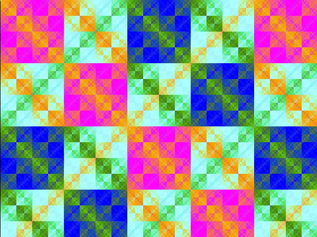

  

# Micro Munch: a VGA demo in a Tiny Tapeout micro tile

Eight scenes of munching squares and Sierpinski carpets, 640x480 at 60 Hz, from 39 flip-flops
in the experimental sky130 **micro tile** (70.38 x 51.68 um; `tiles: "micro"` in info.yaml).

- [The datasheet](docs/info.md): how it works, the inputs, how to test it
- [src/tt_um_pettit_micro.v](src/tt_um_pettit_micro.v): the design, one file
- [HARDEN.md](HARDEN.md): the local LibreLane runs, what the micro tile holds and the settings that made it fit



## Simulation

```sh
cd test
make                       # RTL: three frames against the cycle-exact model (test/model.py)
make GATES=yes             # the same on gate_level_netlist.v (needs PDK_ROOT)
cd render && make UI=8 T0=90   # frame_8_0.png: scene 0 held, frame count 90
```

## Hardening locally

```sh
cd harden
make harden TAG=rc2        # runs/rc2/final/{gds,lef,pnl,...}; python3 metrics.py runs/rc2
make synth TAG=s1          # synthesis only (seconds): the area
```

`harden/configure.py` builds the LibreLane configuration the way tt-support-tools does for a
micro tile (routing up to met3, met2 / met3 power grid; met4 belongs to the container project).

## What is Tiny Tapeout?

Tiny Tapeout is an educational project that makes it easier and cheaper than ever to get your
digital and analog designs manufactured on a real chip. See https://tinytapeout.com.
